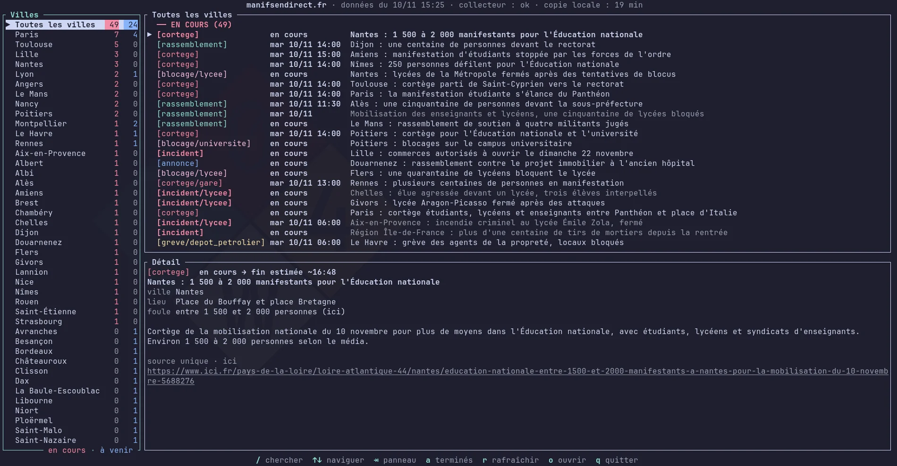

<div align="center">

# ✊ revoltui

[English](README.md) · **Français**

Une interface terminal **non officielle** pour [manifsendirect.fr](https://www.manifsendirect.fr)

Suivez les mobilisations en cours et à venir (cortèges, rassemblements, grèves, blocages…), sans quitter votre terminal.



[](LICENSE)


</div>

> [!NOTE]
> `revoltui` n'est pas affilié à [manifsendirect.fr](https://www.manifsendirect.fr).
>
> Toutes les données proviennent du flux public du site et appartiennent à ses auteurs.

## Installation

Il vous faut une [chaîne d'outils Rust](https://rustup.rs). Installez ensuite la dernière version
depuis GitHub :

```sh
cargo install --git https://github.com/coko7/revoltui
```

Ou depuis un clone local :

```sh
git clone https://github.com/coko7/revoltui
cd revoltui
cargo install --path .
```

## Utilisation

```sh
revoltui [OPTIONS] [CITY]...
```

`CITY` pré-remplit la recherche de ville. La recherche ignore la casse et les accents et accepte
les noms partiels : `lyon`, `st-nazaire` ou `baule` fonctionnent. Sans ville, toutes les villes
sont affichées.

```sh
revoltui                     # toutes les villes
revoltui paris               # démarrer filtré sur Paris
revoltui -c paris            # idem, avec la liste des villes masquée
revoltui -a lyon             # inclure les événements déjà terminés aujourd'hui
revoltui -m 10 rennes        # rafraîchir les données quand elles ont plus de 10 minutes
revoltui -n                  # hors ligne : utiliser uniquement la dernière copie téléchargée
revoltui -f events.json      # lire une copie locale du flux
curl -s https://www.manifsendirect.fr/data/events.json | revoltui -f -
```

### Options

| Option | Description |
| --- | --- |
| `-f`, `--file <FILE>` | Copie locale du flux. Par défaut : `~/.cache/manifsendirect/events.json`. `-` la lit depuis l'entrée standard |
| `-m`, `--max-age <MIN>` | Retélécharger les données quand la copie locale a plus de `MIN` minutes (par défaut : `30`) |
| `-r`, `--refresh` | Retélécharger les données maintenant |
| `-n`, `--offline` | Ne jamais télécharger, utiliser la copie locale telle quelle |
| `-a`, `--all` | Afficher aussi les événements terminés |
| `-c`, `--hide-cities` | Démarrer avec la liste des villes masquée (`v` la réaffiche) |
| `-h`, `--help` | Afficher l'aide (en anglais) |
| `-V`, `--version` | Afficher la version |

La variable d'environnement `MANIFS_URL` remplace l'adresse depuis laquelle les données sont
téléchargées.

## L'écran

- **En-tête** : date de publication des données, état du collecteur du site et âge de votre copie
  locale.
- **Villes** (à gauche) : les villes où il se passe quelque chose. Le nombre rouge compte les
  événements en cours, le bleu les événements à venir. La première ligne, *Toutes les villes*,
  affiche d'un coup toutes les villes de la liste. Appuyez sur `v` pour masquer la liste et donner
  toute la largeur aux événements.
- **Événements** (en haut à droite) : les événements de la ville sélectionnée, regroupés en
  *En cours*, *À venir* et, si activé, *Terminé*. La couleur de l'étiquette indique le type
  d'événement : cortège, rassemblement, grève, blocage, incident, annonce.
- **Détail** (en bas à droite) : tout ce que l'on sait de l'événement sélectionné : heure de début
  et fin estimée, lieu, estimation de la foule, résumé, confirmation par plusieurs sources, et lien
  vers l'article le plus récent.
- **Pied de page** : les touches disponibles, ou le résultat de la dernière action.

## Touches

| Touche | Action |
| --- | --- |
| `/` | Rechercher une ville. Tapez pour filtrer, `Entrée` pour garder le filtre, `Échap` pour l'effacer |
| `v` | Afficher ou masquer la liste des villes |
| `Tab` / `Maj+Tab` | Panneau suivant / précédent |
| `h` `l` / `←` `→` | Aller au panneau de gauche / de droite (`Entrée` va aussi à droite) |
| `j` `k` / `↓` `↑` | Déplacer la sélection, ou faire défiler le détail |
| `Ctrl+d` / `Ctrl+u` | Une demi-page vers le bas / le haut |
| `PgDn` / `PgUp` | Dix lignes vers le bas / le haut |
| `g` `G` / `Début` `Fin` | Première / dernière ligne, ou haut / bas du détail |
| `a` | Afficher ou masquer les événements terminés |
| `r` | Rafraîchir les données maintenant (avec `-n`, relire la copie locale à la place) |
| `o` | Ouvrir le dernier article de l'événement dans votre navigateur |
| `Échap` | Effacer le filtre de ville |
| `q` / `Ctrl+c` | Quitter |

Pendant la saisie d'une recherche, les raccourcis d'édition habituels fonctionnent :

| Touche | Action |
| --- | --- |
| `←` `→` / `Ctrl+←` `Ctrl+→` | Déplacer le curseur d'un caractère / d'un mot (`Alt` fonctionne comme `Ctrl`) |
| `Début` `Fin` / `Ctrl+a` `Ctrl+e` | Début / fin de la recherche |
| `Ctrl+w` / `Ctrl+Retour arrière` / `Alt+Retour arrière` | Supprimer le mot avant le curseur |
| `Retour arrière` / `Suppr` | Supprimer le caractère avant / sous le curseur |
| `Ctrl+Suppr` / `Alt+d` | Supprimer le mot après le curseur |
| `Ctrl+u` / `Ctrl+k` | Supprimer tout ce qui précède / suit le curseur |
| `↑` `↓` / `Ctrl+d` | Parcourir la liste des villes pendant la saisie |

## Données et rafraîchissement

Le flux est enregistré dans `~/.cache/manifsendirect/events.json` (ou
`$XDG_CACHE_HOME/manifsendirect/`) et retéléchargé dès qu'il a plus de `--max-age` minutes, au
démarrage comme pendant que revoltui reste ouvert. Si un téléchargement échoue, revoltui continue
d'afficher la copie dont il dispose et le signale dans le pied de page.

revoltui a besoin d'un terminal interactif : il ne démarre pas si sa sortie est redirigée vers un
fichier ou un pipe.
