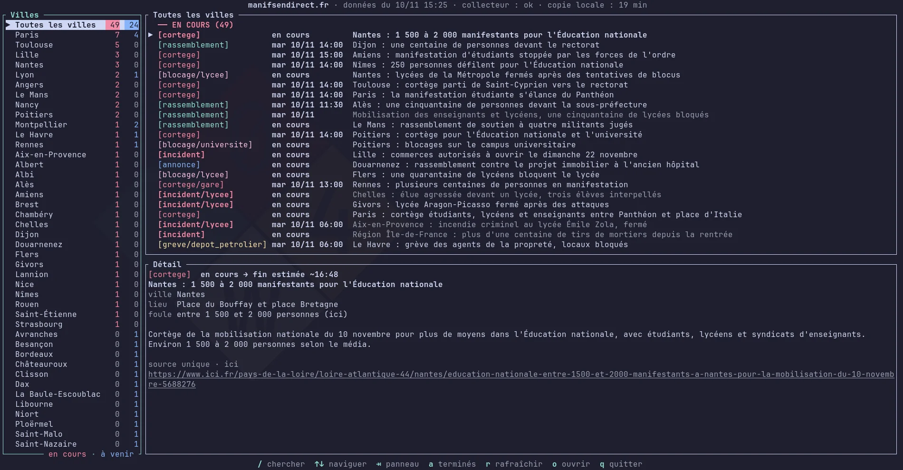

<div align="center">

# ✊ revoltui

An **unofficial** terminal interface for [manifsendirect.fr](https://www.manifsendirect.fr):
browse ongoing and upcoming mobilisations (marches, rallies, strikes, blockades…) city by city,
without leaving your terminal.

> revoltui is not affiliated with manifsendirect.fr. All data comes from the site's public feed
> and belongs to its authors. The interface itself is in French, like the data it shows.



[](LICENSE)


</div>

## Installation

You need a [Rust toolchain](https://rustup.rs). Then install the latest version from GitHub:

```sh
cargo install --git https://github.com/coko7/revoltui
```

Or install from a local clone:

```sh
git clone https://github.com/coko7/revoltui
cd revoltui
cargo install --path .
```

## Usage

```sh
revoltui [OPTIONS] [CITY]...
```

`CITY` pre-fills the city search. Matching ignores case and accents and accepts partial names,
so `lyon`, `st-nazaire` or `baule` all work. Leave it out to browse every city.

```sh
revoltui                     # every city
revoltui paris               # start filtered on Paris
revoltui -a lyon             # include events that already ended today
revoltui -m 10 rennes        # refresh the data when it is older than 10 minutes
revoltui -n                  # offline: use the last downloaded copy only
revoltui -f events.json      # read a local copy of the feed
curl -s https://www.manifsendirect.fr/data/events.json | revoltui -f -
```

### Options

| Option | Description |
| --- | --- |
| `-f`, `--file <FILE>` | Local copy of the feed. Default: `~/.cache/manifsendirect/events.json`. `-` reads it from standard input |
| `-m`, `--max-age <MIN>` | Re-download the data when the local copy is older than this many minutes (default: `30`) |
| `-r`, `--refresh` | Re-download the data now |
| `-n`, `--offline` | Never download, use the local copy as is |
| `-a`, `--all` | Also show events that have ended |
| `-h`, `--help` | Show help |
| `-V`, `--version` | Show the version |

The `MANIFS_URL` environment variable overrides the address the data is downloaded from.

## The screen

- **Header**: when the data was published, the status of the site's collector, and how old your
  local copy is.
- **Villes** (left): cities with something going on. The red number counts events happening now,
  the blue one upcoming events. The top row, *Toutes les villes*, shows every city in the list at
  once. Press `v` to hide the list and give the events the full width.
- **Events** (top right): the selected city's events, grouped into *En cours* (ongoing),
  *À venir* (upcoming) and, when enabled, *Terminé* (ended). The colour of the tag gives the type
  of event: cortège, rassemblement, grève, blocage, incident, annonce.
- **Détail** (bottom right): everything known about the selected event: start time and expected
  end, place, crowd estimate, summary, whether several sources confirm it, and a link to the most
  recent article.
- **Footer**: available keys, or the result of the last action.

## Keys

| Key | Action |
| --- | --- |
| `/` | Search cities. Type to filter, `Enter` to keep the filter, `Esc` to clear it |
| `v` | Show or hide the city list |
| `Tab` / `Shift+Tab` | Next / previous pane |
| `h` `l` / `←` `→` | Move to the pane on the left / right (`Enter` also moves right) |
| `j` `k` / `↓` `↑` | Move the selection, or scroll the detail pane |
| `Ctrl+d` / `Ctrl+u` | Half a page down / up |
| `PgDn` / `PgUp` | Ten rows down / up |
| `g` `G` / `Home` `End` | First / last row, or top / bottom of the detail pane |
| `a` | Show or hide ended events |
| `r` | Refresh the data now (with `-n`, re-read the local copy instead) |
| `o` | Open the event's latest article in your browser |
| `Esc` | Clear the city filter |
| `q` / `Ctrl+c` | Quit |

## Data and refreshing

The feed is saved to `~/.cache/manifsendirect/events.json` (or `$XDG_CACHE_HOME/manifsendirect/`)
and re-downloaded when it gets older than `--max-age` minutes, both at startup and while revoltui
stays open. If a download fails, revoltui keeps showing the copy it already has and says so in the
footer.

revoltui needs an interactive terminal: it will not start if its output is redirected to a file or
a pipe.
